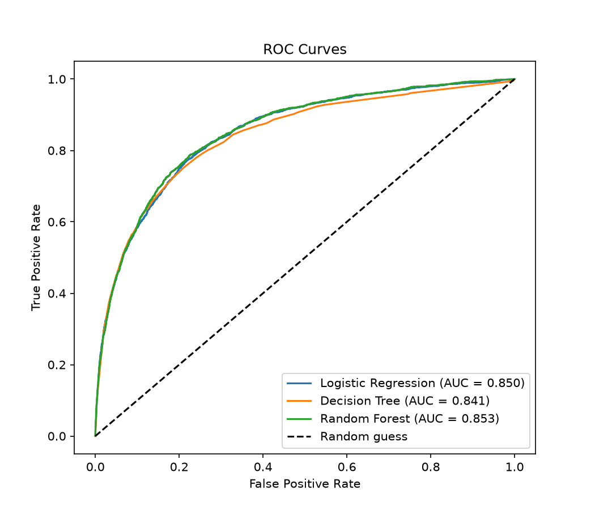
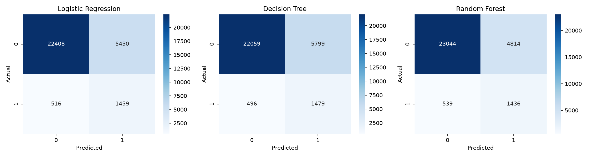
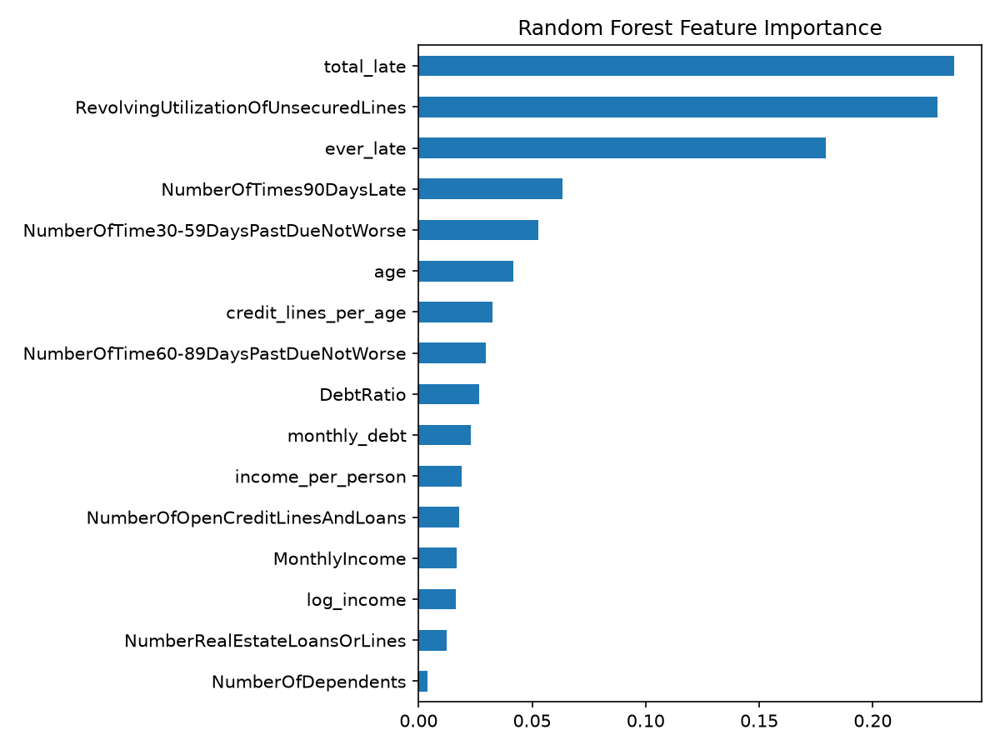

# Credit Scoring Model | CodeAlpha ML Internship (Task 1)

## Objective
Predict whether a borrower will face serious delinquency (default) within 2 years,
using past financial data.

## Dataset
"Give Me Some Credit" (Kaggle competition): about 150,000 borrowers with features such as
age, monthly income, debt ratio, credit utilization and late-payment history.
Source: https://www.kaggle.com/c/GiveMeSomeCredit

Target: `SeriousDlqin2yrs` (1 = default). Only about 7% of borrowers default, so the data is imbalanced.

## Approach
1. **Data cleaning:** removed duplicates, filled missing income and dependents with the median,
   removed invalid ages and error codes (96/98) in the late-payment columns,
   and capped extreme outliers at the 99th percentile.
2. **Feature engineering:** created `total_late`, `ever_late`, `monthly_debt`,
   `income_per_person`, `log_income` and `credit_lines_per_age`.
3. **Train/test split:** 80% / 20%, stratified to keep the default ratio.
4. **Class imbalance:** handled with `class_weight='balanced'` in all models.
5. **Models:** Logistic Regression (scaled features), Decision Tree, Random Forest.

## Results
| Model               | Precision | Recall | F1    | ROC-AUC   |
|                     |           |        |       |           |
| Logistic Regression | 0.211     | 0.739  | 0.328 | 0.850     |
| Decision Tree       | 0.203     | 0.749  | 0.320 | 0.841     |
| Random Forest       | 0.230     | 0.727  | 0.349 | **0.853** |

**Best model: Random Forest** (highest ROC-AUC and F1).





## Key findings
- The most important features were `total_late` (0.236), `RevolvingUtilizationOfUnsecuredLines` (0.228)
  and `ever_late` (0.179). Two of the top three are features I engineered.
- All three models catch about 73-75% of real defaulters (recall).
- Precision is around 0.20-0.23 because defaulters are rare and balanced class weights
  flag more borrowers as risky. This is a deliberate trade-off, since missing a defaulter costs more than a false alarm.
- Accuracy alone would be misleading (a model that always predicts "no default" is about 93% accurate),
  so Recall, F1 and ROC-AUC were used.

## How to run
1. Install the libraries:
```
   pip install -r requirements.txt
```
2. Download `cs-training.csv` from the Kaggle link above and put it in the `data/` folder.
3. Open `notebook.ipynb` and click Run All.

## Future improvements
- Tune hyperparameters with GridSearchCV.
- Try SMOTE and gradient boosting (XGBoost).
- Adjust the decision threshold to balance precision and recall.

## Tools
Python, pandas, NumPy, scikit-learn, matplotlib, seaborn